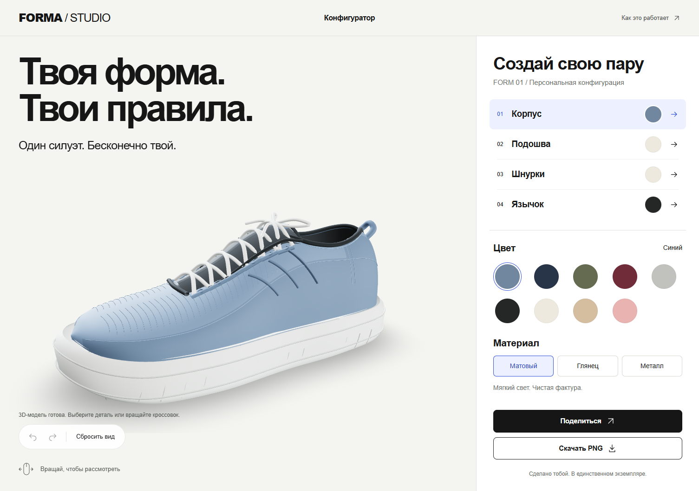

# FORMA Studio

3D-конфигуратор кроссовка: вращение модели, независимый выбор цвета и материала четырёх частей, история изменений, ссылка на конфигурацию и экспорт PNG. Светлая студия с русским интерфейсом, доступными с клавиатуры настройками и адаптивной панелью.

**Демо:** [FORMA Studio на Vercel](https://rushing-tundra-vr3u7th.tmp.now) — временная публикация, созданная 26 октября 2026. Без закрепления владельцем она истекает через час; постоянный адрес появится после авторизации Vercel.




GIF записан из работающего приложения: изменение цветов, вращение и сброс камеры, 14 кадров / 972 KB.

[Мобильное превью](docs/mobile-preview.png). На экране до 768 px стандартная пара сначала показывается изображением: кнопка «Открыть 3D», выбор детали, цвета, материала или сброс вида запускают интерактивную сцену. Ссылка с изменённой конфигурацией сразу загружает 3D, чтобы показывать именно сохранённую пару. На широком экране сцена запускается автоматически.

## Возможности

- Корпус, подошва, шнурки и язычок: девять цветов, три PBR-материала, плавный переход между вариантами.
- Выбор детали на модели или в панели; камера приближает выбранную часть. Ручное вращение сразу прерывает автоматический подлёт.
- Undo/redo до 50 шагов. Изменения одной детали с интервалом до 400 мс объединяются. Работают Ctrl/⌘ Z и Ctrl/⌘ Shift Z.
- Конфигурация сохраняется в URL. Пример: `?body=olive-metallic&sole=white-matte&lace=navy-glossy&tongue=black-matte`.
- PNG текущего ракурса с ключом конфигурации в имени; копирование ссылки и ручной fallback при недоступном Clipboard API.
- Прогресс загрузки, повторная загрузка при ошибке, статичное изображение без WebGL, восстановление после потери графического контекста.
- Навигация Tab/стрелками, живые объявления изменений, системная настройка уменьшения движения. На узком экране панель располагается под сценой.

## Стек

Версии зафиксированы в `package.json` и `package-lock.json`; воспроизводимая установка — `npm ci`.

| Назначение     | Пакеты и версии                                                                                                 |
| -------------- | --------------------------------------------------------------------------------------------------------------- |
| Интерфейс      | React / React DOM **19.3.1**, TypeScript **5.9.3**                                                              |
| Сборка и стили | Vite **8.3.5**, Tailwind CSS / Vite plugin **4.3.3**                                                            |
| 3D             | Three.js **0.186.1**, React Three Fiber **9.8.2**, Drei **10.7.9**                                              |
| Состояние      | Zustand **5.0.16**                                                                                              |
| Тесты          | Vitest **5.0.5**, Testing Library React **16.3.3**, user-event **14.6.8**, jest-dom **7.0.1**, jsdom **28.1.0** |
| Проверки       | ESLint **10.13.0**, typescript-eslint **8.72.0**, Prettier **3.9.10**                                           |
| Runtime        | Node.js **24.x**, npm; Node 24 указан в `engines` и CI                                                          |

TypeScript включает `strict`, `noUncheckedIndexedAccess`, проверки неиспользуемых переменных и аргументов. Для запуска не нужны сервер, API-ключи или база данных.

## Запуск и проверки

```sh
npm ci
npm run dev
```

Открыть адрес, который напечатает Vite, обычно `http://127.0.0.1:5173`. Для проверки production-сборки:

```sh
npm run build
npm run preview
```

```sh
npm run lint
npm run format:check
npm run typecheck
npm test
```

В текущем наборе 44 теста: валидация и сериализация URL, гидратация до записи адреса, история, клавиатура, radio-группы, диалоги, готовность PNG, Clipboard API и отложенный мобильный запуск сцены. Дополнительно пройдены 12 браузерных сценариев в headless Edge 156: модель, вращение, материалы, URL в другой вкладке, PNG, клавиатура, ошибки/retry и fallback; проверены мобильная активация и загрузка статичного изображения. Эмуляция мобильной ширины не заменяет физический телефон. GitHub Actions повторяет проверки и сборку на PR и push в `main`/`master`; наличие workflow само по себе не означает, что удалённый запуск уже состоялся.

## Ключевые решения

**Сцена и интерфейс связаны через Zustand.** `configStore` хранит пользовательский результат и историю, `uiStore` — готовность сцены, наведение и команды экспорта/сброса камеры. React-компоненты подписываются селекторами на нужные поля; материалы и камера обновляются в `useFrame` без `setState` на каждом кадре.

**Модель клонирует изменяемые материалы.** `useGLTF` кэширует ресурс, поэтому изменение общего материала могло бы испортить другие экземпляры. Геометрия остаётся общей, материалы принадлежат экземпляру и освобождаются при размонтировании. Границы `Box3` задают центр и масштаб автоматически.

**Rim-эффект расширяет стандартный PBR-материал.** `onBeforeCompile` добавляет подсветку силуэта, сохраняя HDRI, шероховатость, металличность и tone mapping. Компромисс: вставки привязаны к shader chunks Three.js и требуют проверки после обновления. [Построчный разбор](docs/engineering.md#шейдер-построчный-разбор).

**URL — переносимая конфигурация.** Значения проверяются на границе приложения. `replaceState` обновляет адрес без создания отдельной записи браузера для каждого клика. `localStorage` не нужен: скопированная ссылка воспроизводит результат в другой вкладке.

**PNG требует одного дополнительного рендера.** `preserveDrawingBuffer` выключен. После завершения перехода материалов приложение рендерит сцену и вызывает `toBlob` в том же задании браузера. Это экономит ресурсы во время обычного взаимодействия; экспорт сохраняет canvas, без HTML-панели.

**Качество адаптируется.** DPR ограничен 2 на широком экране и 1,5 на узком; при устойчивом падении FPS `PerformanceMonitor` снижает его до 1. Мобильная сцена использует HDRI 512 px и тень 512 вместо desktop HDRI 1K и тени 1024. Тень статичной геометрии рассчитывается один раз; скрытая вкладка приостанавливает цикл рендера.

**Мобильный старт требует решения пользователя.** Сначала загружаются интерфейс и статичное превью; пользовательская активация подгружает отдельный чанк `React.lazy`. Это уменьшает начальную работу CPU/GPU для посетителя, который ещё не открыл 3D. `compileAsync` подготавливает шейдеры до запуска цикла кадров; одной этой подготовки оказалось недостаточно для целевого Lighthouse. Поэтому мобильный поток изменён явно для всех пользователей, без определения аудитора или таймерной задержки. Стоимость запуска 3D сохраняется после активации и измеряется отдельно.

## Измерения и бюджеты

Таблица отделяет свойства файлов и локальные браузерные наблюдения от ещё не проведённых измерений. Увеличение геометрии отражает доработку формы, а не эффект сжатия.

| Метрика                                | Исходная версия                  | Финальная версия / цель                              |
| -------------------------------------- | -------------------------------- | ---------------------------------------------------- |
| GLB, фактический размер                | 1 530 164 B ≈ 1,53 MB / 1,46 MiB | **1 539 904 B**, максимум 8 MB                       |
| Треугольники модели                    | 61 236                           | **61 556**                                           |
| Меши / материалы                       | 11 / 11                          | **11 / 11**                                          |
| Draw calls кадра                       | Не замерены                      | **12** в локальном headless-прогоне; бюджет ≈100     |
| FPS, локальный headless host           | Не замерены                      | **165** в пяти коротких пробах, Edge156, DPR1        |
| FPS, физический телефон                | Не замерены                      | Цель 30+; эмуляция не заменяет устройство            |
| Lighthouse mobile Performance          | **62**, автоматический запуск 3D | **95**, стандартное мобильное превью с активацией    |
| Lighthouse A11y / Best Practices / SEO | **96 / 100 / 91**                | **100 / 100 / 100**                                  |
| FCP / LCP / TBT                        | **2,20 с / 2,99 с / 3 906 мс**   | **1,40 с / 2,90 с / 27 мс**                          |
| Начальный JS / чанк сцены              | Не замерены                      | **240,70 / 76,03 KB** UI; **1075,01 / 294,25 KB** 3D |

[Воспроизводимый протокол, команды оптимизации и шаблон результатов](docs/performance.md).

[Сохранённые результаты Lighthouse и браузерной проверки](docs/verification.json).

Lighthouse: 26 октября 2026, версия 13.5.0, Edge/Chromium 156 headless, локальная production-сборка, симуляция mobile с CPU ×4. Каждое число относится к одному запуску, не к медиане. **95 измерено для стандартного мобильного превью до открытия 3D.** Изменённая share-ссылка загружает модель автоматически и включает полную стоимость WebGL; результат 95 на неё не переносится. Промежуточный полный запуск после графических улучшений дал 61, что и привело к изменению мобильного потока. Ни Lighthouse, ни 165 FPS на host не подтверждают производительность физического телефона.

## Архитектура и развитие

```text
src/
  components/scene/  Canvas, Model, CameraRig, Loader, SceneRuntime
  components/ui/     Panel, PartList, Swatches, Toolbar, диалоги, ошибки
  config/            части, палитра, материалы, пути модели и HDRI
  stores/            конфигурация/история и временное состояние интерфейса
  lib/               URL, PNG, доступность, radio-навигация
  shaders/           GLSL-вставки для подсветки силуэта
  hooks/             синхронизация URL, reduced motion
  tests/             логика, DOM и интеграция
scripts/             генерация исходной 3D-модели
docs/                устройство проекта и измерения
```

[Инженерный разбор, типичные ошибки и учебный план](docs/engineering.md). [Устройство модели и её замена](docs/model.md). Модель собственная, небрендированная; HDRI Poly Haven распространяется по CC0. Источники и лицензии — в [assets-LICENSE.txt](public/assets-LICENSE.txt).

## Что можно объяснить на собеседовании

Проект показывает границу между React-состоянием и GPU-анимацией; владение материалами при кэшировании ресурсов; разницу между цветом, roughness и metalness; работу нормалей в пространстве камеры; проверку внешних URL; транзакции истории; доступность сложного визуального интерфейса. Эти решения разобраны с привязкой к исходникам, чтобы формулировки можно было подтвердить кодом.

Дальнейшие улучшения: измерить энергопотребление и рассмотреть `frameloop="demand"` с корректной инвалидацией; добавить профессиональную модель с UV и текстурами; проверить KTX2 на физических устройствах; расширить браузерные тесты WebGL; проверить экранные дикторы и контраст вручную. Каждое изменение стоит сравнивать с зафиксированной базовой версией.

## Vercel

В репозитории есть `vercel.json`: framework Vite, build `npm run build`, output `dist`. После авторизации владельца можно импортировать репозиторий в Vercel или выполнить `npx vercel` из его каталога. Текущая версия уже опубликована через официальный `vercel deploy --temporary`; для постоянного размещения нужно закрепить её в аккаунте и заменить временный URL выше.

Временная публикация возвращает HTTP 200; изменённая конфигурационная ссылка проверена в отдельном браузере. Закрепление в аккаунте Vercel и измерения на физическом телефоне требуют участия владельца. Приватная ссылка закрепления сохранена локально в `.vercel/temporary-deployment.json` и не входит в Git. Статус CI — см. GitHub Actions.
