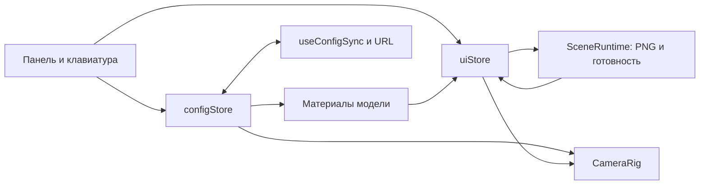

# Как устроен FORMA Studio

Документ связывает решения с исходниками и даёт материал для самостоятельного разбора. Версии зависимостей перечислены в [README](../README.md); сигнатуры Drei дополнительно сверены с установленными декларациями `node_modules/@react-three/drei/core/Gltf.d.ts`.

## Границы ответственности

`App.tsx` собирает HTML-оболочку; `SceneViewport` отвечает за превью и ленивое подключение сцены. `Presets`, `ComparisonControls`, `CameraViews` и `ExportOptions` добавляют desktop-инструменты в существующую структуру, без замены визуальной системы. `Panel` не обращается к камере или WebGLRenderer; `Model` не вызывает методы панели. Обе стороны читают данные и отправляют команды через сторы.

Новые контролы видны от 769 px. Мобильный интерфейс и его повторная оценка производительности находятся за рамками этой доработки. [Концепт](design-desktop-v2.png), [актуальный desktop-скриншот](desktop-v2.png) и [протокол проверки](desktop-features-verification.json) хранятся отдельно от материалов базового коммита `45fecee`.

`configStore` хранит `selectedPart`, конфигурацию, `past`, `future` и состояние сравнения: `comparisonSnapshot`, `comparisonDraft`, `isComparing`. `uiStore` хранит выбранный ракурс и размер PNG, готовность сцены и временные команды: увеличение `viewRevision` запрашивает ракурс или сброс камеры, увеличение `screenshotRequested` — новый экспорт. Счётчик сохраняет повторные одинаковые действия, которые булев флаг мог бы потерять.

`SceneRuntime` находится внутри Canvas и имеет доступ к renderer/scene/camera. Поэтому он выполняет команду PNG, а библиотечная функция `lib/screenshot.ts` отвечает только за рендер, Blob и загрузку файла. Свет оставлен в `Scene.tsx`: несколько деклараций не требуют отдельного компонента `Lights`. Fallback также находится рядом со сценой, поскольку зависит от наличия WebGL и потери контекста.

## Мобильное превью и запуск 3D

На ширине до 768 px `shouldStartScene` сравнивает проверенную конфигурацию URL с дефолтной. Для стандартной пары `SceneViewport` показывает изображение и доступную кнопку «Открыть 3D». Пока пользователь не активировал сцену, её динамический import не вызывается. Выбор детали, цвета, материала и сброс камеры тоже устанавливают `uiStore.sceneActivated=true`: дополнительный клик для настройки не требуется.

Изменённая ссылка сразу запускает 3D даже на узком экране, поскольку стандартное фото не изображает пользовательскую конфигурацию. Невалидный или посторонний query не превращает стандартную пару в изменённую. На широком экране автозапуск сохранён. Логика не зависит от user-agent, Lighthouse или искусственного таймера.

Это продуктовый компромисс: начальный просмотр стандартной модели дешевле по CPU/GPU, но первое открытие интерактивной сцены включает загрузку и подготовку. В отчётах нужно различать загрузку превью и время до готовности 3D после клика. Архивный Lighthouse 95 относится к мобильному превью коммита `45fecee`; полный запуск изменённой share-ссылки и текущая desktop-доработка этим числом не описываются. Промежуточная версия baseline с немедленным 3D дала 61 даже после графических улучшений. Нового мобильного замера в этой доработке нет.

После загрузки ассетов `SceneRuntime` вызывает `renderer.compileAsync(scene, camera)`. До окончания подготовки `frameloop="never"`; после неё сцена становится готовой и запускает кадры. На поддерживаемых устройствах используется параллельная компиляция шейдеров; другие расходы загрузки и инициализации остаются. Ошибка подготовки передаётся ближайшему error boundary.

Компактная сцена выбирает HDRI 512 px, DPR до 1,5 и тень 512; широкая — HDRI 1K, DPR до 2 и тень 1024. При `visibilitychange` скрытая вкладка останавливает цикл и монитор FPS. После возвращения цикл возобновляется. Это не даёт неактивной вкладке понизить качество на основании искусственно ограниченного браузером FPS.

## Почему React не обновляется 60 раз в секунду

`Swatches` подписывается на выбранную часть и её конфигурацию, `Toolbar` — на наличие истории, камера — на выбранную часть и команду сброса. Изменение `hoveredPart` не перерисовывает всю панель. В `useFrame` модель читает наведение через `useUiStore.getState()` и меняет объекты Three.js напрямую.

`Model` один раз на загруженный GLB создаёт клон дерева и своих материалов через `useMemo`. Векторы направления камеры также создаются один раз. `useEffect` обновляет целевые значения только после пользовательского действия; цикл кадров приближает к ним текущий цвет, roughness, metalness и rim strength. Это соответствует рекомендациям [R3F о быстрых обновлениях](https://r3f.docs.pmnd.rs/advanced/pitfalls).

Коэффициент `1 - exp(-14 * delta)` даёт почти завершённый переход за 300 мс и одинаковый темп на экранах с разной частотой. Ограничение `delta` до 0,1 секунды смягчает скачок после зависшего кадра. При reduced motion коэффициент становится 1. Здесь нет нового `Color`, `Vector3`, материала или React `setState` на каждом кадре.

Материалы освобождаются через `dispose` при размонтировании. Геометрия и текстуры остаются во владении кэша загрузчика; `dispose={null}` предотвращает случайное освобождение общих ресурсов. Это осознанное разделение владения, а не универсальный запрет на disposal.

## Данные, URL и история

Контракт: `ShoeConfig = Record<PartId, { color: ColorId; material: MaterialId }>`. Типы помогают внутри приложения, но строка URL проверяется во время выполнения. Значение должно иметь ровно две части, например `red-matte`. Неизвестный цвет, материал или неверный формат возвращает дефолт этой детали. Посторонние query-параметры не участвуют в конфигурации и сохраняются вместе с hash и `history.state`.

`useConfigSync` сначала читает адрес и загружает стор, затем подключает подписку на изменения. Обратный порядок мог бы перезаписать входящую ссылку дефолтами. `popstate` заново загружает адрес и очищает историю конфигуратора. `replaceState` не создаёт браузерный шаг на каждый swatch: история браузера и undo приложения решают разные задачи.

Первое изменение кладёт снимок предыдущей конфигурации в `past`. Следующее изменение той же детали в пределах 400 мс использует этот снимок, включая смену цвета и материала. Другая деталь, переключение выбора, undo, redo, reset или load завершают группу. Новое изменение после undo очищает `future`; повтор уже выбранного значения ничего не добавляет и не удаляет redo. Reset можно отменить. История ограничена 50 элементами, снимки копируются.

Клавиатурный обработчик проверяет Ctrl/⌘ Z, физический `KeyZ` и Shift для redo. Он оставляет нативную историю input/textarea/select/contenteditable и не перехватывает уже обработанное событие.

### Готовые палитры как одна транзакция

`PRESETS` в [presets.ts](../src/config/presets.ts) содержит четыре полные конфигурации: «Монохром», «Песок», «Ночной город», «Акцент». Последние две меняют не только цвет, но и материалы. UI определяет выбранную палитру сравнением всей конфигурации, поэтому ручная правка сразу снимает выбор, если результат перестал совпадать.

`applyConfig(config: unknown)` сначала проверяет `isShoeConfig`, затем клонирует весь результат и добавляет предыдущую конфигурацию в историю один раз. Четыре последовательных вызова `updatePart` дали бы несколько шагов undo и промежуточные состояния URL. Здесь одно undo возвращает всю прежнюю пару, а redo повторяет палитру. Валидная совпадающая конфигурация завершает группу редактирования и просмотр A без новой записи истории и без потери доступного redo; невалидные входные данные игнорируются.

### Сравнение A/B и история

«Запомнить A» создаёт отдельный снимок текущей видимой конфигурации: копируются четыре объекта частей, затем они и общий объект замораживаются через `Object.freeze`. Сохранение снимка само по себе не добавляет undo. После сохранения кнопка называется «Обновить A»; при просмотре A она недоступна. Снимок содержит цвета и материалы, без камеры.

| Действие                                            | Видимая конфигурация и история                                                                                                                                  |
| --------------------------------------------------- | --------------------------------------------------------------------------------------------------------------------------------------------------------------- |
| «Показать A»                                        | Текущий B сохраняется отдельно в `comparisonDraft`, на сцене показывается копия A. Если конфигурация изменилась, предыдущий B добавляется одним шагом в `past`. |
| «Вернуться к B»                                     | Восстанавливается сохранённый B, временный `comparisonDraft` очищается. Изменение также отменяемое.                                                             |
| Правка цвета, материала или палитры при просмотре A | Редактируется видимый A и получается новый B; режим сравнения завершается. Сам сохранённый A не меняется, прежний B остаётся в истории.                         |
| Undo / redo                                         | Восстанавливают конфигурацию и выходят из просмотра A. История не восстанавливает режим сравнения и не переписывает снимок A.                                   |
| Перезагрузка или загрузка конфигурации из URL       | Снимок A и временный B очищаются. Восстанавливается только конфигурация, записанная в ссылке.                                                                   |

Если A и B совпадают, переключение меняет режим, но не создаёт дубликат в истории. Важный пример: запомнить синюю пару как A, сделать красный B, показать A и изменить подошву. Первое undo вернёт видимый синий A без режима сравнения, второе — прежний красный B. Снимок A остаётся исходным до «Обновить A» или перезагрузки. История по-прежнему ограничена 50 шагами.

Панель, модель, URL, ссылка и PNG используют один `config`, поэтому всегда относятся к видимому варианту. Снимок A, временный B и флаг сравнения не сериализуются. Открытие ссылки во второй вкладке не переносит состояние сравнения.

## Камера без борьбы с OrbitControls

`CameraRig` хранит конечные `position` и `target` в переиспользуемых `Vector3`. При выборе детали получает точку `focus` из конфига. В каждом кадре одновременно приближает к цели камеру и `controls.target`, затем вызывает `controls.update()`. Менять только положение камеры недостаточно: OrbitControls продолжил бы смотреть на прежнюю точку.

`CAMERA_VIEWS` в [views.ts](../src/config/views.ts) задаёт три ракурса: «Три четверти», «Сбоку» и «Сверху». `uiStore.setCameraView` обновляет идентификатор и `viewRevision`, так что повторный выбор того же ракурса тоже запускает команду. Сброс выбирает «Три четверти», не меняя выбранную часть или конфигурацию.

При выборе ракурса и изменении размера `CameraRig` рассчитывает расстояние по вершинам мешей модели в мировых координатах, учитывая вертикальный и горизонтальный угол обзора, глубину и запас 10%. Плоскость контактной тени исключена. Обход геометрии выполняется при смене вида или размера, а не в `useFrame`. Верхний ракурс немного отклонён от оси Y, чтобы направление взгляда не совпадало с `camera.up`.

`onStart` останавливает автоматический полёт сразу после начала ручного жеста и снимает выделение готового ракурса. Подлёт к выбранной части также снимает его. Изменение размера окна после свободного вращения не возвращает камеру к пресету. Damping отключается при reduced motion; переход к целевой позиции становится мгновенным. Ракурс — временное состояние интерфейса, он не входит в конфигурационную историю и URL.

Pan выключен, distance и polar angle ограничены. `touch-action: pan-y` возвращается после подключения OrbitControls: библиотека выставляет собственное значение. Вертикальная прокрутка страницы остаётся нативной; горизонтальное движение используется для вращения. Поведение двухпальцевого жеста следует дополнительно проверять на физических iOS/Android-устройствах.

## Шейдер: построчный разбор

Исходник: [hoverRim.ts](../src/shaders/hoverRim.ts). Выбран `MeshStandardMaterial.onBeforeCompile`, потому что нужен маленький эффект поверх готового PBR. `ShaderMaterial` дал бы полный контроль, но потребовал бы отдельно реализовать либо подключить освещение, отражения, tone mapping и согласование цвета. Hook относится к WebGLRenderer; при переходе на WebGPURenderer этот подход нужно пересмотреть. API описан в [Material](https://threejs.org/docs/pages/Material.html#onBeforeCompile).

| Строка / вставка                                     | Что происходит                                                                                         |
| ---------------------------------------------------- | ------------------------------------------------------------------------------------------------------ |
| `const strength = { value: 0 }`                      | Создаётся стабильный объект uniform; рендер-цикл будет менять только число.                            |
| `material.onBeforeCompile = (shader) => …`           | GLSL меняется перед компиляцией стандартного материала.                                                |
| `shader.uniforms.uRimStrength = strength`            | JS-объект связывается с uniform фрагментного шейдера.                                                  |
| `varying vec3 vRimNormal;` в vertex shader           | Объявляется вектор нормали, который интерполируется между вершинами.                                   |
| `varying vec3 vRimView;` в vertex shader             | Объявляется направление от поверхности к камере.                                                       |
| `#include <defaultnormal_vertex>`                    | Сначала выполняется штатное преобразование нормали Three.js.                                           |
| `vRimNormal = normalize(transformedNormal);`         | Нормаль приводится к единичной длине; она уже в пространстве камеры.                                   |
| `#include <project_vertex>`                          | Three.js рассчитывает `mvPosition` и позицию вершины на экране.                                        |
| `vRimView = -mvPosition.xyz;`                        | В view-space камера находится в нуле; отрицание позиции даёт направление к ней.                        |
| `uniform float uRimStrength;` в fragment shader      | Объявляется общая для материала интенсивность эффекта.                                                 |
| `varying vec3 vRimNormal;` и `vRimView`              | Принимаются интерполированные значения vertex shader.                                                  |
| `normalize(vRimNormal)`, `normalize(vRimView)`       | Повторная нормализация нужна после интерполяции.                                                       |
| `dot(…, …)`                                          | Скалярное произведение равно косинусу угла: около 1 спереди и около 0 на силуэте.                      |
| `clamp(…, 0.0, 1.0)`                                 | Ограничивает диапазон, чтобы обратная сторона и численная погрешность не усиливали свет бесконтрольно. |
| `pow(1.0 - rimFacing, 3.0)`                          | Инверсия выделяет края; куб концентрирует свечение ближе к силуэту.                                    |
| `vec3(0.48, 0.70, 0.88)`                             | Задаёт холодный оттенок дополнительного света в вычислениях шейдера.                                   |
| `outgoingLight += … * rim * uRimStrength`            | Добавляет подсветку к PBR-результату до штатного вывода и tone mapping.                                |
| `#include <opaque_fragment>`                         | Сохраняет стандартную стадию вывода и работу прозрачности материала.                                   |
| `customProgramCacheKey = () => 'forma-hover-rim-v1'` | Идентифицирует эту GLSL-модификацию для кэша программ; uniforms остаются разными у экземпляров.        |
| `return strength`                                    | Возвращает ссылку циклу кадров; изменение интенсивности не требует перекомпиляции.                     |

Одинаковый cache key не отменяет остальные варианты Three.js: материал с другой картой или shader define всё ещё может потребовать отдельную GPU-программу. При обновлении Three.js нужно проверить наличие точек вставки, компиляцию в браузере и визуальный результат. Этот rim использует геометрическую нормаль, поэтому будущая normal map не будет автоматически менять его рисунок.

## Экспорт PNG и его компромисс

В `Canvas` стоит `preserveDrawingBuffer: false`. `SceneRuntime` фиксирует выбранный размер при запросе и ждёт 400 мс стабильной конфигурации и камеры. Изменение материала, ракурса или ручное вращение начинает отсчёт заново; в скрытой вкладке захват откладывается. Это предотвращает экспорт промежуточного кадра.

`ExportOptions` предлагает «Экран» и «2048 px». Первый вариант использует реальное разрешение drawing buffer, включая текущий DPR, а не CSS-размер элемента. Второй задаёт ровно 2048 пикселей по длинной стороне, пересчитывая короткую с округлением и сохраняя соотношение сторон. Например, canvas 1200 × 800 даёт PNG 2048 × 1365. Это новый рендер сцены в нужном разрешении, без растягивания маленькой картинки.

`captureScreenshot` сохраняет размер renderer, DPR, viewport, scissor, render target, cube face и mip level. Затем выбирает default framebuffer. Для 2048 px временно устанавливает DPR 1 и новый размер через `setSize(..., false)`: CSS и resize observer R3F не затрагиваются. Сцена рендерится текущей камерой, а `drawImage` копирует готовые пиксели в отдельный 2D-canvas в том же синхронном задании браузера, пока WebGL-буфер ещё доступен.

В `finally`, до любого `await`, восстанавливаются все сохранённые параметры и при необходимости экранный кадр. Только после восстановления отдельный canvas кодируется через `toBlob`. Даже ошибка копирования не должна оставлять интерфейс в экспортном размере. Очередь в `WeakMap` сериализует запросы одного renderer; ошибка одного экспорта не блокирует следующий.

Захват через default framebuffer сохраняет штатный путь tone mapping и преобразования выходного цвета, включая гамму. Обычный промежуточный render target в используемой Three.js r186 не даёт того же display tone mapping автоматически. Здесь не меняются камера, aspect, exposure, clear color или CSS, и не добавляется повторная цветовая коррекция. PNG содержит только 3D-сцену, без HTML-панели. Имя включает безопасный `configurationKey` видимого варианта и суффикс `-2048` для большого размера; object URL освобождается после начала загрузки.

## Как добавить данные

Новая готовая палитра добавляется в `PRESETS` как полная `ShoeConfig`; отдельный формат URL для неё не нужен. Новый ракурс задаётся в `CAMERA_VIEWS` направлением и смещением target; кнопки берутся из того же массива. После изменения проверить фокус с клавиатуры, выделение, подгонку модели под кадр и экспорт в обоих размерах.

Новый цвет или материал добавляется в `COLORS` / `MATERIALS` в [parts.ts](../src/config/parts.ts): UI, валидаторы URL и списки выводятся из этих массивов. ID должны оставаться стабильными и не содержать дефис — дефис разделяет цвет и материал в URL.

Для новой части изменения прикладного кода ограничены тем же `parts.ts`: расширить `PartId`, добавить запись в `PARTS` с label/meshNames/focus, добавить дефолт в `DEFAULT_CONFIG` и копирование в `cloneConfig`. TypeScript подсветит неполные записи. Также сама GLB должна содержать геометрию этой части и `extras.part` с тем же ID. Это изменение ассета, а не JSX. Предпочтительно присваивать метаданные; имена мешей служат резервным сопоставлением.

У новой модели сначала проверить оси, границы, нормали и материалы. Путь находится в `config/model.ts`. Сцена нормализует размер, но композицию камеры и focus для модели другой формы нужно проверить визуально. Подробности — в [model.md](model.md).

## Ошибки и их диагностика

| Симптом                                 | Что проверить                                                                                |
| --------------------------------------- | -------------------------------------------------------------------------------------------- |
| Перекрашиваются сразу несколько деталей | Общие экземпляры материалов; клонирование материала и корректный `extras.part`.              |
| Цвет в PNG отличается от выбранного     | Экспорт во время перехода; color space и tone mapping; актуальность ключа конфигурации.      |
| URL открывается с дефолтами             | Порядок гидратации и подписки; точные ID; разделитель `-`; тест `configSync`.                |
| Камера дёргается при вращении           | Автополёт не отключён в `onStart` или target меняется отдельно от позиции.                   |
| Retry повторяет старую ошибку           | Отклонённый Promise остался в кэше `useGLTF` / `useEnvironment`; очистить кэш перед remount. |
| WebGL чёрный или пропал                 | Console с ошибкой GLSL, Network с GLB/HDRI, контекст и аппаратное ускорение.                 |
| UI обновляется каждый кадр              | React Profiler; `setState` / запись стора внутри `useFrame`; слишком широкая подписка.       |
| FPS низкий при небольшом GLB            | DPR, тени, shader cost и GPU; размер загрузки не равен стоимости кадра.                      |
| Tab проходит через все swatches         | У выбранного radio должен быть `tabIndex=0`, у остальных `-1`.                               |

## Учебный план по 1–3 дня

Это порядок изучения уже подготовленного проекта и логические границы будущих изменений. Сообщения ниже предложены для истории разработки; они не означают, что такие коммиты уже созданы.

| Этап               | Срок / сложность  | Результат и проверка                                                | Основной риск                    | Conventional commit                                    |
| ------------------ | ----------------- | ------------------------------------------------------------------- | -------------------------------- | ------------------------------------------------------ |
| Основа и данные    | 1 день / низкая   | Strict TS, Vite, конфиг частей; сборка и lint                       | Несовместимые версии             | `chore: scaffold strict React and Vite workspace`      |
| Сцена и модель     | 2–3 дня / высокая | GLB/HDRI, центрирование, свет, OrbitControls; проверить все ракурсы | Нормали, лицензия, вес           | `feat: add configurable shoe scene and lighting`       |
| Панель и материалы | 1–2 дня / средняя | Swatches, клавиатура, lerp; меняется одна часть                     | Общие материалы и лишние рендеры | `feat: add accessible part and finish controls`        |
| URL и история      | 1–2 дня / средняя | Ссылка воспроизводится, undo/redo; Vitest                           | Перезапись URL до гидратации     | `feat: persist configuration in URL with undo history` |
| Камера и GLSL      | 2 дня / высокая   | Подлёт, reduced motion, rim; проверить прерывание жестом            | Разные пространства нормалей     | `feat: add camera focus and hover rim shader`          |
| Экспорт и сбои     | 1–2 дня / средняя | PNG, progress, retry, fallback; заблокировать GLB                   | Пустой canvas и кэш ошибки       | `feat: add PNG export and resilient scene loading`     |
| Профиль и релиз    | 2–3 дня / высокая | Production build, измерения, CI, Vercel                             | Подмена замеров бюджетами        | `perf: tune rendering and document measured budgets`   |

На каждом этапе полезно сначала назвать ожидаемое поведение, затем найти соответствующий тест и пройти сценарий руками. Для шейдера временно менять степень `3.0` и интенсивность, сравнивая силуэт. Для истории — воспроизвести цепочку «цвет → материал → undo → redo → новая правка» и объяснить содержимое обоих стеков.
